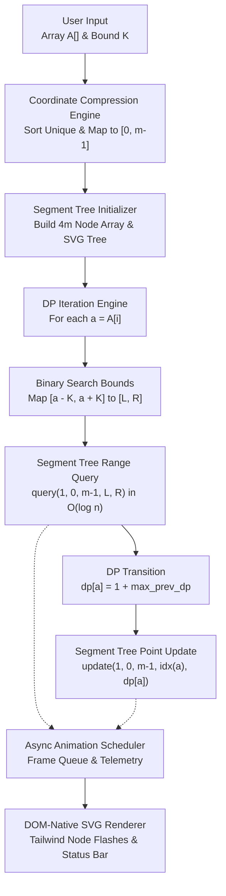
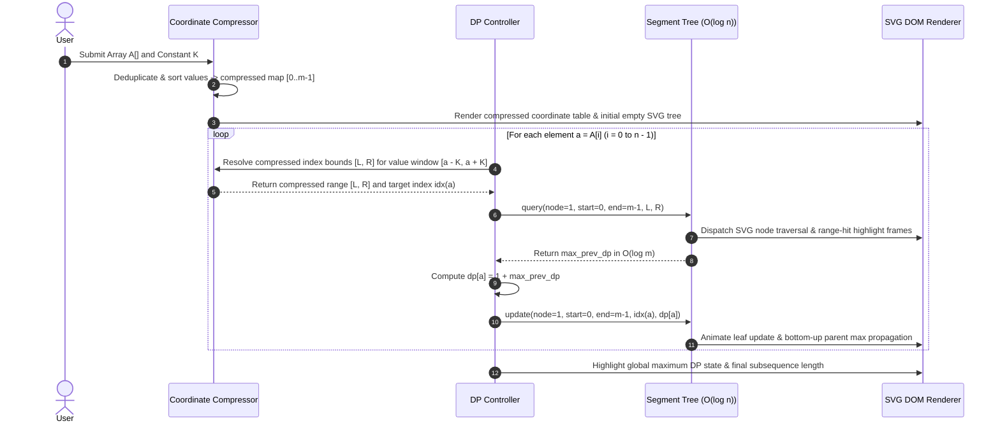

<div align="center">

# SegDPVisualizer | Flat Subsequence (Segment Tree + DP) Engine

#### 🔗 [Live Deployment Link](https://flat-subsequence-segment-tree-dp-vi.vercel.app/)

A web-based, interactive visualizer for the $O(n \log n)$ algorithm that solves the "Longest Flat Subsequence" problem using Dynamic Programming and a Segment Tree.

### High-performance **algorithmic visualization engine**: $O(n \log n)$ Dynamic Programming + Coordinate Compression + Segment Tree Range Queries + DOM-Native SVG Rendering

[](https://flat-subsequence-segment-tree-dp-vi.vercel.app/)
[](https://developer.mozilla.org/)
[](https://tailwindcss.com/)
[](https://developer.mozilla.org/)
[](https://developer.mozilla.org/en-US/docs/Web/SVG)
[-00C853?style=flat)]()
[]()
[](LICENSE)

**Raw Input ($A, K$) -> Coordinate Compression ($10^9 \to [0, m-1]$) -> Segment Tree Range Query $[A[i]-K, A[i]+K]$ -> DP State Transition -> Real-Time SVG Node Animation**

<h4>
  <a href="https://flat-subsequence-segment-tree-dp-vi.vercel.app/">View Live Deployment</a>
  <span> · </span>
  <a href="#quick-start-local">Quick Start</a>
  <span> · </span>
  <a href="#architecture">Architecture</a>
</h4>

</div>

---

A zero-dependency, web-based **interactive algorithmic engine** engineered to visualize how **Coordinate Compression** and a **Segment Tree** optimize a classic $O(n^2)$ Dynamic Programming recurrence down to **$O(n \log n)$** for the **Longest Flat Subsequence** problem ($\max(S) - \min(S) \le K$). It decouples pure ES6+ algorithmic state mutations from an asynchronous **DOM-native SVG rendering pipeline**, providing frame-by-frame inspection of range queries, point updates, and tree traversals.

## Table of Contents
1. [The Engineering Problem & Solution](#the-engineering-problem--solution)
2. [Features](#features)
3. [Architecture](#architecture)
4. [Algorithmic Execution Lifecycle](#algorithmic-execution-lifecycle)
5. [Tech Stack](#tech-stack)
6. [Project Structure](#project-structure)
7. [Quick Start (Local)](#quick-start-local)
8. [Core Engine Modules](#core-engine-modules)
9. [Mathematical & Architectural Deep-Dive](#mathematical--architectural-deep-dive)
10. [Runtime Parameters & Controls](#runtime-parameters--controls)
11. [Roadmap](#roadmap)
12. [Troubleshooting](#troubleshooting)
13. [Contributing & License](#contributing--license)

---

## The Engineering Problem & Solution

> **The Problem:** Given an integer array $A$ of size $n$ and a bound $K$, finding the longest subsequence $S$ where adjacent or bounded elements satisfy $\vert{}A[i] - A[j]\vert{} \le K$ via standard Dynamic Programming requires scanning all prior indices $j < i$ for each element—yielding an $O(n^2)$ time complexity that times out (TLE) on competitive programming constraints ($n \le 10^5$). Furthermore, indexing DP states directly by element values fails when $A[i] \le 10^9$ due to memory limits (MLE).

**The Algorithmic & Systems Solution:**
1. **The Coordinate Compression Layer ($O(n \log n)$ time):** Extracts all unique values in $A$, sorts them, and maps arbitrary values up to $10^9$ into a dense, contiguous index space $[0, m-1]$ where $m \le n$.
2. **The Segment Tree Acceleration Layer ($O(\log n)$ per op):** Replaces the $O(n)$ linear lookback scan with a range-maximum **Segment Tree** built over the compressed value space, querying the valid value window $[A[i] - K, A[i] + K]$ and performing point updates in $O(\log n)$ time.
3. **The Decoupled SVG Rendering Layer (`Zero-Dependency ES6+`):** Separates tree state transitions from UI painting using an asynchronous frame scheduler that targets individual DOM-native `<svg>` nodes via CSS utility selectors without `<canvas>` pixel-redraw overhead.

---

## Features

| Feature | Description |
|---|---|
| **$O(n \log n)$ DP Engine** | Optimizes the Longest Flat Subsequence recurrence from quadratic $O(n^2)$ scans to logarithmic range queries |
| **Coordinate Compression** | Dynamically maps sparse, large input values into a compact $[0, m-1]$ index array to prevent memory overflow |
| **DOM-Native SVG Tree** | Generates a responsive binary Segment Tree using vector graphics, enabling granular CSS node flashing (`query`, `update`, `hit`) |
| **Step-by-Step Telemetry** | Real-time status bar and mathematical hint engine explaining active range bounds $[a - K, a + K]$ and DP transitions |
| **Custom Test Suites** | Supports arbitrary user-defined arrays $A$ and distance thresholds $K$ for testing corner cases |
| **Zero-Dependency Core** | Built strictly from first principles using Vanilla JavaScript (ES6+) with zero external animation or graphing libraries |
| **Decoupled State Loop** | Asynchronous event scheduler isolating pure data structure operations from DOM layout recalculations |

---

## Architecture



<details>
<summary>ASCII version</summary>

```text
          ┌──────────────────────────────────────────────────────────┐
          │                User Input & Control Layer                │
          │            Custom Array A[] · Bound K · Speed            │
          └────────────────────────────┬─────────────────────────────┘
                                       │
          ┌────────────────────────────▼─────────────────────────────┐
          │              Coordinate Compression Module               │
          │    Extract Unique -> Sort O(n log n) -> Map [0..m-1]     │
          └────────────────────────────┬─────────────────────────────┘
                                       │
          ┌────────────────────────────▼─────────────────────────────┐
          │            Core DP + Segment Tree State Engine           │
          │   Range Max Query [a-K, a+K] · Point Update O(log n)     │
          └──────┬─────────────────────┬──────────────────────┬──────┘
                 │                     │                      │
          1. Query Range        2. Compute DP[a]       3. Mutate Tree
                 │                     │                      │
          ┌──────▼──────┐    ┌─────────▼───────────┐   ┌──────▼──────┐
          │ Binary      │    │ dp[a] = 1 +         │   │ O(log n)    │
          │ Search [L,R]│    │ max_prev_dp         │   │ Leaf->Root  │
          └──────┬──────┘    └─────────┬───────────┘   └──────┬──────┘
                 └─────────────────────┼──────────────────────┘
                                       │
                         Structured Animation Events
                                       │
          ┌────────────────────────────▼─────────────────────────────┐
          │                DOM-Native SVG Rendering Layer            │
          │    Node Highlighting · Edge Traversal · Live Telemetry   │
          └──────────────────────────────────────────────────────────┘
```
</details>

---

## Algorithmic Execution Lifecycle



<details>
<summary>Text version</summary>

```text
User submits Array A and threshold K
  │
  ├─ 1. Coordinate Compression:
  │     ├─ Extracts unique elements from A and sorts them in ascending order
  │     └─ Maps each unique value v to a dense index idx(v) ∈ [0, m - 1]
  ├─ 2. Tree Construction:
  │     └─ Allocates a Segment Tree of size 4m initialized to 0 and mounts SVG nodes
  ├─ 3. Iterative DP + Segment Tree Pipeline (for each a = A[i]):
  │     ├─ Computes valid value interval [a - K, a + K]
  │     ├─ Binary searches compressed array to find index range [L, R]
  │     ├─ Queries Segment Tree on [L, R] in O(log m) to get max_prev_dp
  │     ├─ Sets dp[a] = 1 + max_prev_dp
  │     └─ Updates Segment Tree at compressed index idx(a) with dp[a] in O(log m)
  └─ 4. Outputs optimal Longest Flat Subsequence length at the root node (tree[1])
```
</details>

---

## Tech Stack

| Layer | Technology |
|---|---|
| **Algorithmic Core** | Vanilla JavaScript (ES6+), Asynchronous Generators / Promise Schedulers |
| **Data Structures** | Range-Maximum Segment Tree, Coordinate Compression Lookup Maps |
| **Graphics Engine** | Scalable Vector Graphics (DOM-Native `<svg>`, `<g>`, `<circle>`, `<line>`, `<text>`) |
| **Styling & UI** | HTML5, TailwindCSS (Utility-driven state transitions & responsive layout) |
| **Deployment** | Vercel Edge Network (Zero-config static deployment) |

---

## Project Structure

```text
Flat-Subsequence-Segment-Tree-DPVisualizer/
├── index.html                  # Main application layout, control panel & SVG viewport
├── script.js                   # Coordinate compression, Segment Tree, DP & SVG animation loop
├── style.css                   # Custom SVG node transitions & keyframe highlights
├── demo.gif                    # Real-time execution preview asset
└── README.md                   # Architectural & mathematical documentation
```

---

## Demo


---

## Quick Start (Local)

### Option A: Instant Zero-Build Execution (Recommended)

Because the engine is built with zero external build dependencies, it runs directly in any modern browser:

```bash
# 1. Clone the repository
git clone https://github.com/itsmeharshkumarsingh/Flat-Subsequence-Segment-Tree-DPVisualizer.git
cd Flat-Subsequence-Segment-Tree-DPVisualizer

# 2. Open directly in your browser
# Windows:
start index.html
# macOS:
open index.html
# Linux:
xdg-open index.html
```

### Option B: Local Development Server

```bash
# Serve via Python's built-in HTTP server or VS Code Live Server
python3 -m http.server 5500
```

| Service | Local URL | Description |
|---|---|---|
| **Interactive Visualizer** | `http://localhost:5500` | Full SVG Segment Tree & DP animation workspace |

---

## Core Engine Modules

| Module / Function | Complexity | Responsibility |
|---|---|---|
| `compressCoordinates(A)` | $O(n \log n)$ | Deduplicates and sorts input array $A$, building bidirectional value-to-index maps |
| `buildSegmentTree(m)` | $O(m)$ | Initializes the $4m$ backing tree array and computes hierarchical SVG $(x, y)$ coordinates |
| `queryMax(node, l, r, ql, qr)` | $O(\log m)$ | Recursively queries maximum DP state within compressed bounds $[ql, qr]$ and queues SVG highlights |
| `updateTree(node, l, r, idx, val)` | $O(\log m)$ | Updates leaf index `idx` with `dp[a]` and propagates $\max(\text{left}, \text{right})$ up to the root |
| `animateStep(eventQueue)` | $O(1)$ / frame | Consumes state transition events and applies Tailwind CSS classes to target `<svg>` DOM nodes |

---

## Mathematical & Architectural Deep-Dive

### 1. From $O(n^2)$ Naive DP to $O(n \log n)$ Segment Tree Optimization

In the naive formulation, computing the longest valid subsequence ending at index $i$ requires checking every prior index $j < i$:

$$dp[i] = 1 + \max_{\substack{0 \le j < i \\ |A[i] - A[j]| \le K}} dp[j]$$

This performs $O(n)$ work per state across $n$ elements, resulting in **$O(n^2)$ time complexity**.

By shifting the DP state from *array indices* to *compressed element values*, let $dp[v]$ represent the best subsequence length ending with value $v$. For each incoming element $a = A[i]$, any valid predecessor value $v$ must lie within the closed interval:

$$v \in [a - K, \, a + K]$$

| Optimization Stage | Mechanism | Complexity Impact |
|---|---|---|
| **1. Coordinate Compression** | Maps $m \le n$ unique values in $A$ to $[0, m-1]$ via sorting + binary search (`lower_bound` / `upper_bound`) | Compresses $10^9$ value range into $O(n)$ memory |
| **2. Range Maximum Query** | Queries the Segment Tree over compressed indices $[L, R]$ corresponding to $[a - K, a + K]$ | Reduces $O(n)$ inner loop scan to **$O(\log n)$** |
| **3. Point State Update** | Updates compressed index $\text{idx}(a)$ with $\max(dp[a], \, 1 + \text{query}(L, R))$ | Maintains prefix invariant in **$O(\log n)$** |

Total time complexity across all $n$ elements drops to **$O(n \log n)$** with **$O(n)$ auxiliary space**.

### 2. Why DOM-Native SVG Over HTML5 `<canvas>`?
- **Granular Node Addressing:** Rather than clearing and repainting an entire bitmap `<canvas>` on every frame, each Segment Tree node is a distinct `<g>` vector element in the DOM. The animation loop directly toggles state classes (`ref`, `query`, `update`) on specific node IDs in $O(1)$ time.
- **Resolution Independence:** Vector nodes, edges, and range labels scale crisply across any viewport or zoom level without pixelation.

---

## Runtime Parameters & Controls

| Parameter | Input Format | Description |
|---|---|---|
| **Input Array (`A`)** | Comma/space-separated integers | Sequence of values to process (e.g., `4, 2, 1, 4, 3, 4, 5, 8, 15`) |
| **Difference Bound (`K`)** | Non-negative integer | Maximum allowed difference $|A[i] - A[j]| \le K$ between adjacent subsequence elements |
| **Playback Controls** | Interactive UI Triggers | Start, pause, reset, and step through tree queries and updates in real time |

---

## Roadmap

- [x] $O(n \log n)$ Coordinate Compression and Range-Maximum Segment Tree engine
- [x] Real-time DOM-native SVG tree generation and node traversal animations
- [x] Live mathematical status bar tracking $[a - K, a + K]$ query intervals
- [ ] Subsequence backtracking pointers to reconstruct and highlight the exact elements of $S$
- [ ] Side-by-side execution benchmark comparing $O(n^2)$ vs. $O(n \log n)$ step counts
- [ ] Exportable SVG/GIF execution traces for competitive programming editorials

---

## Troubleshooting

| Problem | Fix |
|---|---|
| SVG tree nodes overlap on large inputs | Keep custom interactive array sizes to $n \le 20$ for optimal visual spacing on standard viewports |
| Input validation error | Ensure the array field contains valid integers separated by commas or spaces and $K \ge 0$ |
| Animations appear instantaneous | Refresh the viewport and verify browser "Reduce Motion" accessibility flags are not overriding CSS transitions |

---

## Contributing & License

Engineered as an algorithmic systems showcase for SDE and Research Engineering technical interviews. While external pull requests are restricted to preserve baseline implementations, architectural feedback and issue reports are always welcome:

1. Fork the repository
2. Create your feature branch (`git checkout -b feature/BacktrackReconstruction`)
3. Commit your changes (`git commit -m 'Add parent pointer reconstruction for optimal subsequence'`)
4. Push to the branch (`git push origin feature/BacktrackReconstruction`)
5. Open a Pull Request

Distributed under the **MIT License**. See [`LICENSE`](LICENSE) for more information.

<div align="center">

### ⭐If you find this algorithmic visualizer useful, give the repository a star.⭐

</div>