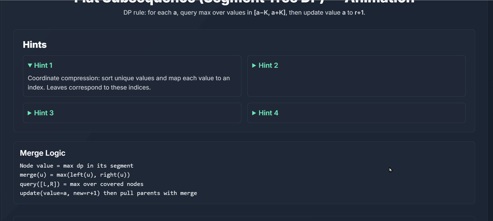

# Flat Subsequence (Segment Tree + DP) Visualizer

A web-based, interactive visualizer for the $O(n \log n)$ algorithm that solves the "Longest Flat Subsequence" problem using Dynamic Programming and a Segment Tree.

This tool is designed to help understand how a Segment Tree, combined with Coordinate Compression, can be used to optimize a DP recurrence relation, reducing the time complexity from $O(n^2)$ to $O(n \log n)$.

## About The Project

This project visualizes the solution to a common competitive programming problem:

> **The Problem:** Given an array of integers `A` and a constant `K`, find the length of the longest subsequence `S` of `A` such that the difference between the maximum and minimum elements in `S` is less than or equal to `K`.
>
> `max(S) - min(S) <= K`

This visualizer provides a step-by-step breakdown of how the algorithm processes each element, performs coordinate compression, updates the DP state, and queries the Segment Tree.

## Features

* **Custom Input:** Enter your own array and a `K` value.
* **Full Animation:** Watch the algorithm build the segment tree, query, and update in real-time.
* **Coordinate Compression:** See how the array values are mapped to a compressed range of indices.
* **Segment Tree Visualization:** Watch the tree nodes (built with **SVG**) flash as they are queried and updated.
* **Clear Explanations:** Hints and a real-time status bar explain each step of the algorithm.

## The $O(n \log n)$ Algorithm Explained

### 1. The $O(n^2)$ DP Solution (The "Slow" Way)

A simple DP approach would be:
Let $dp[i]$ be the length of the longest flat subsequence ending at index $i$ (i.e., $A[i]$ is the last element).

To calculate $dp[i]$, we look at all previous elements $j < i$:
$dp[i] = 1 + \max(dp[j])$ for all $j < i$ where $\text{abs}(A[i] - A[j]) \le K$.

This requires an $O(n)$ scan for each $i$, leading to an overall $O(n^2)$ complexity.

### 2. The $O(n \log n)$ DP + Segment Tree Solution

We can optimize this significantly. The recurrence doesn't depend on the *index* $j$, but on the *value* $A[j]$.

1.  **Our DP State:** Let $dp[v]$ be the length of the longest flat subsequence ending with the **value** $v$.
2.  **The Challenge:** The values $v$ can be very large (e.g., up to $10^9$), making an array of size $v$ impossible.
3.  **The Solution (Part 1): Coordinate Compression**
    We only care about the values present in the input array `A`. We can sort the unique values in `A` (let's say there are $m$ unique values) and map them to new indices $0, 1, \dots, m-1$.
4.  **The Solution (Part 2): Segment Tree**
    We use a Segment Tree built over the **compressed indices** (from $0$ to $m-1$). Each node in the tree will store the maximum $dp$ value seen so far in its corresponding value range.
5.  **The Algorithm:**
    * Iterate through the input array `A` from $i = 0$ to $n-1$. Let the current element be $a = A[i]$.
    * **Query:** Find the best previous subsequence by querying the Segment Tree for the maximum $dp$ value in the *value range* **`[a - K, a + K]`**. (We find the compressed indices corresponding to this value range and query those). Let this result be `max_prev_dp`.
    * **Calculate:** The new DP value for the value `a` is: dp[a] = 1 + max\_prev\_dp
    
    * **Update:** Update the Segment Tree at the *compressed index* for $a$ with this new, larger value $dp[a]$.

Since each query and update operation on the Segment Tree takes $O(\log n)$ time, the total time complexity is reduced to $O(n \log n)$.

## Getting Started

To get a local copy up and running, follow these simple steps.

1.  **Clone the repo:**
    ```sh
    git clone [https://github.com/itsmeharshkumarsingh/Flat-Subsequence-Segment-Tree-DPVisualizer.git](https://github.com/itsmeharshkumarsingh/Flat-Subsequence-Segment-Tree-DPVisualizer.git)
    ```
2.  **Enter the project directory:**
    ```sh
    cd Flat-Subsequence-Segment-Tree-DP-Visualizer
    ```
3.  **Launch the visualizer instantly (No build pipeline required):**
    Simply open the `index.html` file in your favorite web browser.


## Architectural & Performance Decisions

* **DOM-Native SVG Animations**: Instead of drawing pixels on an isolated `<canvas>` context, this project generates a responsive tree architecture using pure Scalable Vector Graphics (SVG). This architecture allows the simulation thread to target individual nodes via CSS selectors, seamlessly triggering transition flashes (`ref`, `query`, `backtrack`) using Tailwind utility classes.
* **Zero-Dependency Core**: Developed purely with vanilla JavaScript (ES6+) and asynchronous loop schedulers. This eliminates heavy framework overhead and ensures the visualizer runs directly out of the box with an absolute minimal memory footprint.
* **State Isolation**: The core Segment Tree module is completely decoupled from the rendering layer. The algorithm executes state updates independently, firing structured events that the visualizer layer intercepts to queue UI frames.

## Technology Stack

* **HTML5:** For the main page structure.
* **TailwindCSS:** For the modern UI and styling.
* **JavaScript (ES6+):** For the core algorithm logic and DOM manipulation.
* **SVG (Scalable Vector Graphics):** For drawing and animating the Segment Tree.

## Demo



---

## Contributing

As this is a proprietary architectural showcase for SDE interview cycles, external contributions are currently restricted. However, architectural feedback is welcome!

1.  Fork the Project
2.  Create your Feature Branch (`git checkout -b feature/AmazingFeature`)
3.  Commit your Changes (`git commit -m 'Add some AmazingFeature'`)
4.  Push to the Branch (`git push origin feature/AmazingFeature`)
5.  Open a Pull Request
